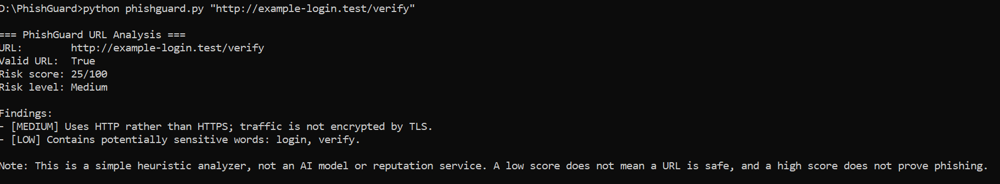
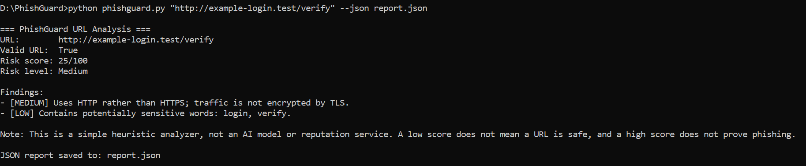

# PhishGuard 🔎

**PhishGuard** is a beginner-friendly Python command-line tool that checks a URL string for common suspicious indicators.

> **Important:** This is a rules-based learning project. It does not visit websites, query threat-intelligence services, or prove that a URL is safe or malicious.

## Features

- Checks basic URL format
- Flags HTTP URLs
- Detects direct IP-address hosts
- Checks for `@`, unusually long URLs, many hyphens/subdomains, and sensitive-looking words
- Produces a simple heuristic score and explanations
- Can export a JSON report
- Uses only Python's standard library

## Requirements

- Python 3.10 or newer recommended
- No third-party packages required

## Run

```bash
python phishguard.py
```

Or provide a URL directly:

```bash
python phishguard.py https://example.com
```

## 📸 Project Screenshot




Save a JSON report:

```bash
python phishguard.py "http://example-login.test/verify" --json report.json
```

## Example

```text
=== PhishGuard URL Analysis ===
URL:        http://example-login.test/verify
Valid URL:  True
Risk score: 25/100
Risk level: Medium
```

## 📸 Project Screenshot



Exact scores may differ as indicators evolve. Treat the output as a demonstration, not a security verdict.

## Run tests

```bash
python -m unittest discover -s tests -v
```

## Limitations

- Does not open or fetch the URL.
- Does not check domain age, DNS, TLS certificates, redirects, or reputation feeds.
- Words such as `login` or `verify` also appear on legitimate websites.
- Attackers can evade simple rules.
- A low score is not proof of safety.

## Roadmap

- [ ] Add unit tests and more URL edge cases
- [ ] Add an optional safe reputation API integration
- [ ] Add a small Flask web interface
- [ ] Add CSV/HTML report export
- [ ] Add a labeled dataset and evaluate any future ML model

## Author

Created by Ashraf kakar

## License

MIT (see `LICENSE`).
